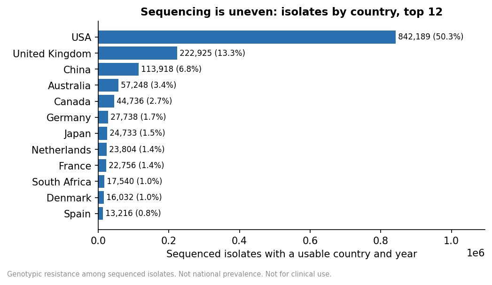
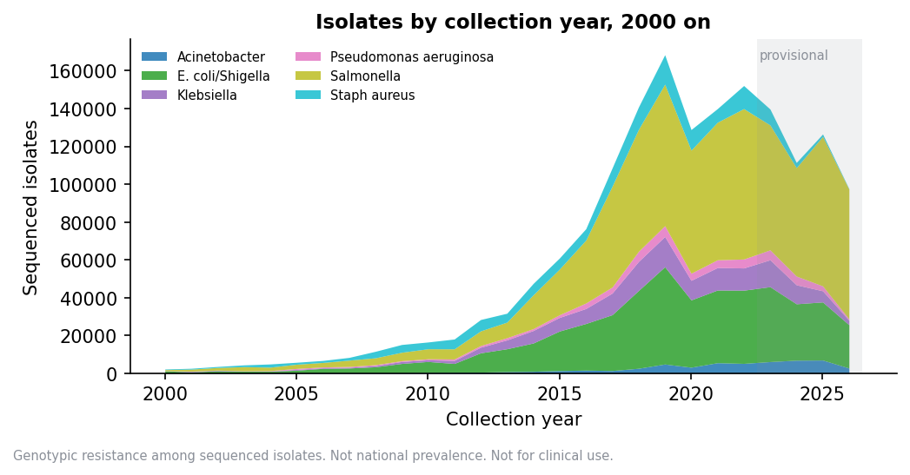
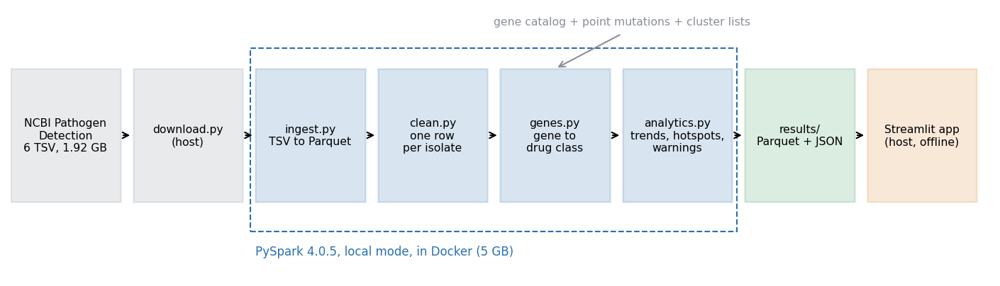
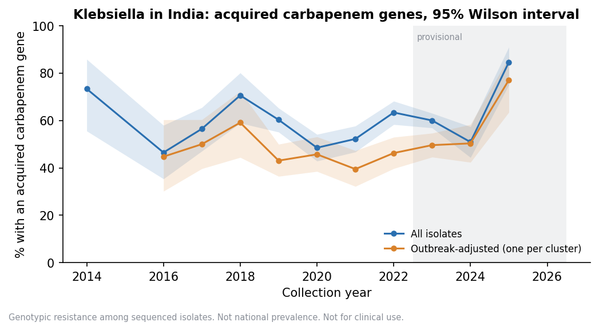
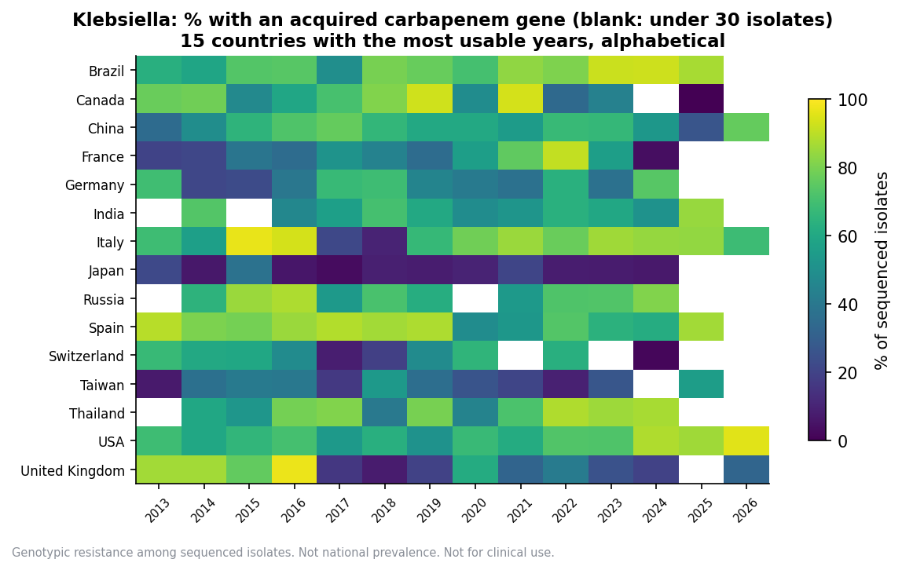
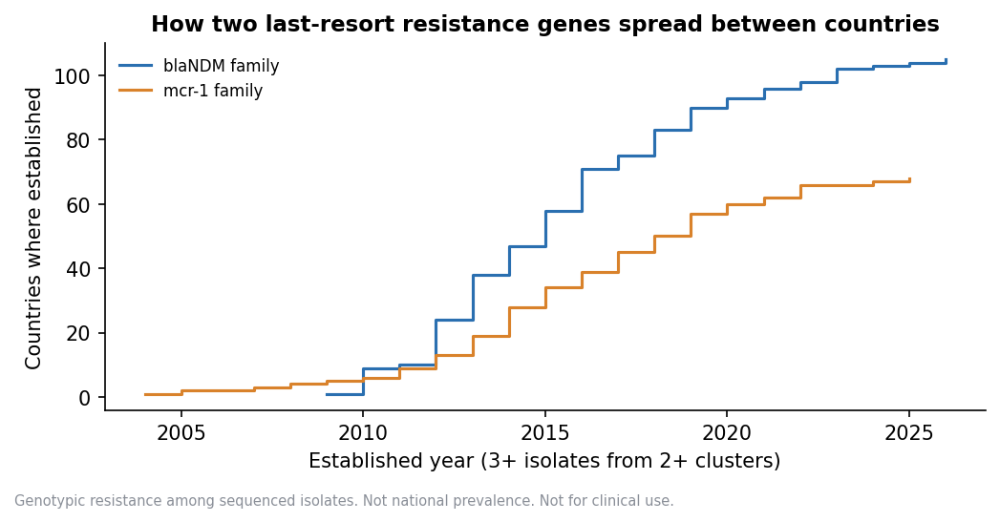
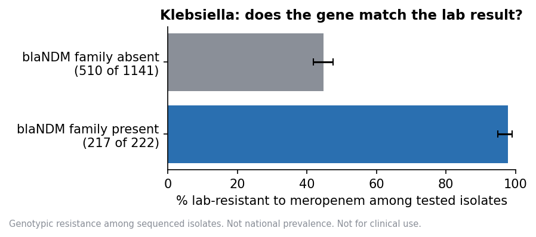
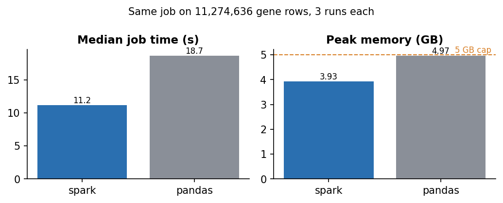

# ResistanceMap: where and when antibiotic resistance is spreading

BDSMA mini project, "SpatioTemporal Data Analytics" option. November 2026.

> **Not for clinical use.** Every figure in this report is *genotypic* resistance *among sequenced isolates*. The data reflects what labs chose to sequence, not all infections, so no figure here is national prevalence. Antibiotics are named only beside resistance evidence. Nothing here recommends a drug.

All numbers come from the files in `results/`, rebuilt by a full pipeline run on 2026-11-06, and are collected in `report/numbers.json` by `report/make_figures.py`.

## 1. Problem
Antibiotic resistance spreads through space and time. A resistance gene appears in one country, becomes established, and turns up in others. Some of the genes that matter most protect bacteria against the last-resort drugs, carbapenems and colistin.

Public genome databases now hold millions of bacterial genomes, each with a country, a collection date and a list of resistance genes found by NCBI's AMRFinderPlus. The raw files are too large and too messy to browse by hand. Dates come in six formats, places are free text, outbreaks put hundreds of near-identical genomes in one year, and recent years are incomplete because uploads lag collection.

ResistanceMap turns these files into answers to four questions, each with its sample size and confidence shown:
1. **Where** is a resistance found, and how common is it among sequenced isolates?
2. **When** did a gene first become established in each country?
3. **What is rising**, and is the rise more than one outbreak?
4. **What has newly arrived**, and how strong is the evidence?

## 2. Users
- **Primary:** public health students and researchers who want a quick, honest view of resistance in a country or for a gene, with the limits of the data stated.
- **Secondary:** doctors, who may read it for context. For this reason the app never tells anyone which drug to use. It does show, for a gene, how often isolates carrying it were resistant in the lab, as evidence on how far the gene can be trusted.

## 3. Data
| Source | Use |
|---|---|
| NCBI Pathogen Detection `.amr.metadata.tsv`, six organisms | Isolates, place, date, resistance genes. The core of every number |
| AMRFinderPlus gene catalog and point-mutation table | Gene to drug class |
| NCBI SNP cluster lists | Genetic clusters, for outbreak adjustment |
| WHO GLASS chart downloads | Comparison only, never merged |
| WHO AWaRe list | Labels on antibiotics only |

Six files from the NCBI release of 2026-11-03 hold **1,991,552 rows, 1.92 GB (1.78 GiB)**. After removing duplicate rows there are **1,991,177 isolates** and, once each gene list is split, **11,274,636 isolate and gene rows**.

| Organism | Rows | Real date % | Real place % | India | Uploaded within 5 years % |
|---|---|---|---|---|---|
| Salmonella | 908,677 | 91.56 | 93.41 | 1,657 | 94.09 |
| E. coli/Shigella | 592,815 | 82.84 | 86.96 | 4,097 | 82.12 |
| Klebsiella | 178,938 | 83.05 | 89.64 | 3,409 | 70.77 |
| Staph aureus | 179,096 | 77.43 | 79.91 | 469 | 68.93 |
| Pseudomonas aeruginosa | 67,170 | 80.42 | 86.46 | 813 | 63.81 |
| Acinetobacter | 64,856 | 89.94 | 91.89 | 1,494 | 78.01 |

The data is heavily skewed. The **USA is 44.53% of isolates and India 0.60%** (11,939). Of 9,470 organism, country and year groups, only **2,848 reach the 30-isolate minimum** used for showing a rate.

Upload delay matters as much as skew. Only Salmonella has 90% of isolates uploaded within 5 years of collection. So 2023 onward is marked **provisional**, and that is a floor, not a guarantee, for the other five organisms.

## 4. Architecture

- **Spark in Docker.** PySpark 4.0.5 runs in local mode in the `apache/spark:4.0.5-python3` container, capped at 5 GB. The host's Java 22 is not supported by Spark, and Docker makes the run repeatable.
- **Parquet throughout.** Raw TSV is converted once. Later steps read only the columns they need, partitioned by organism.
- **Prepared results.** The pipeline writes 33 tables and JSON files to `results/` (20 MB). The Streamlit app reads only these, so it runs on a laptop with Docker stopped.
- **Settings in files.** Thresholds (minimum sample, provisional years, hotspot margin, rising test) are in `config/settings.json`, so they can be changed without code changes.

| Step | Script | Output |
|---|---|---|
| Download | `download.py` | Raw files, with versions in a manifest |
| Ingest | `ingest.py` | Parquet, row counts checked against the source |
| Audit | `profile_data.py` | `data_profile.json`: fill rates, date formats, upload delay |
| Clean | `clean.py` | One row per isolate, standard country and year, flags with reasons |
| Genes | `genes.py` | One row per isolate and gene, with drug class |
| Analytics | `analytics.py` | Rates, trends, hotspots, warnings, first seen, cluster watch |
| Checks | `sanity_checks.py`, `method_check.py`, `timing.py` | Validation files |

## 5. Methods
**Cleaning.** Missing values arrive as `NULL`, `missing`, `not collected` and similar placeholders, which are never treated as places or dates. Countries come from the part of `geo_loc_name` before the colon, matched to ISO codes in `config/countries.csv`. Years come from six date formats. Ranges that span years and dates before 1910 or after upload are flagged and left out of yearly views, never guessed. Every flagged row is kept with its reason.

**Gene to drug class.** Each gene entry is looked up in the AMRFinderPlus catalog, preferring the organism's own taxon: exact allele first, then gene family. Point mutations are matched on the mutation table for the species. Where catalog rows disagree, only the drugs all of them list are kept, so a gene is never counted towards a drug some of its alleles do not affect. Every match records how it was made, and 99.878% of entries were matched.

**Prevalence.** For each organism, country, year and drug class: isolates with at least one gene in the class, divided by all isolates. Isolates with no resistance genes stay in the denominator. Dropping them would inflate every rate. Each rate has a **Wilson 95% interval**, and rates are hidden below 30 isolates.

**Confidence label.** From the width of the interval: stronger up to 10 points, moderate up to 25, weak above that.

**Outbreak adjustment.** Isolates in the same NCBI SNP cluster in the same country and year count once. Isolates outside any cluster count individually. This separates "more of the same outbreak was sequenced" from "the resistance is more widespread".

**Rising.** Over the ten years before the provisional period (2013 to 2022), with at least 5 usable years: a weighted slope above zero and a Cochran-Armitage trend test with z of at least 1.96. A second slope that includes provisional years is shown with a label.

**First seen and established.** `first_year` is the earliest record. `established_year` is the first year by which a gene has at least 3 isolates from at least 2 clusters in that country. The report leads with `established_year`, because single early records are often date errors.

**Early warnings.** Genes established in a country in the last 3 data years, with at least 3 isolates from 2 clusters in that window. Rows where the country had fewer than 30 earlier isolates of that organism are marked `new_sequencing`, because every gene looks new where sequencing has just begun. The app hides those by default.

**Hotspots.** A group whose lower confidence limit is more than 10 points above the same organism, class and year in all other countries combined, or a class that is rising in that country. Comparing with "all other countries" stops the USA being compared mostly with itself. These are flags to look at, not findings, and the app never ranks countries.

**Last-resort drugs.** Carbapenem and colistin resistance, split by mechanism: acquired genes, point mutations, disrupted genes (such as `oprD` loss in Pseudomonas) and intrinsic genes (the OXA-51 family in Acinetobacter). Acquired genes lead, because they spread between bacteria.

**Gene and lab agreement.** For the 24,803 isolates with lab results, the share lab-resistant with and without each gene.

## 6. The app
Eleven pages, each answering one question: Map and trends, Search, Early warnings, Last-resort drugs, Gene profile, Cluster watch, Country report (with download), Compare countries, Guided questions, Evidence panel and About the data. Search says whether a pathogen, serovar, strain, NCBI taxonomy ID or disease is covered and how good the data is. For a disease it lists possible pathogens from a hand-checked list, never a diagnosis, beside what submitters recorded in the free-text `host_disease` field. Every rate page offers the all-isolates or outbreak-adjusted view, a clinical-only filter and three-year pooled periods for small samples. Every rate is shown with its count, interval and confidence label. A notice on every page says the figures are not for clinical use.

## 7. Findings
All among sequenced isolates, genotypic resistance.

### 7.1 Klebsiella in India: no clear rise in acquired carbapenem genes

- **All isolates, 2013 to 2022:** 918 of 1,610 isolates over 8 usable years. Slope 0.06 points a year, z 0.08. **Not flagged as rising.**
- **Including provisional years:** slope 0.64, z 1.55. Not significant.
- **Outbreak-adjusted:** 414 of 916 over 7 years. Slope -0.87, z -0.92.
- **Clinical isolates only:** 861 of 1,321 over 7 years. Slope 1.44, z 1.91, just under 1.96. This is close, so it should not be stated as a firm "no rise".

The level is high throughout, about half or more in most years. That reflects in part which isolates labs chose to sequence, as carbapenem-resistant Klebsiella are a common target for sequencing.

### 7.2 Klebsiella across countries

Rates of acquired carbapenem genes differ widely between countries and years. The blank cells are years under 30 isolates, which is most of the world for most years. Differences between countries partly reflect sequencing policy, so the chart is ordered alphabetically, not ranked.

### 7.3 Spread of `blaNDM` and `mcr-1`

- **`blaNDM`** (carbapenem): on record in 123 countries, established in 105. The earliest established country is **India, in 2009**, which fits the gene's first description from a 2008 case linked to New Delhi.
- **`mcr-1`** (colistin): on record in 84 countries, established in 68. The earliest established is **China, in 2004**, earlier than its 2015 discovery. That fits look-back studies of stored isolates.

### 7.4 Other results
- **Isolates with acquired genes for both last-resort drugs:** 1,165 (E. coli/Shigella 950, Klebsiella 209, Acinetobacter 3, Salmonella 3, none in Pseudomonas or Staph aureus).
- **Early warnings:** 1,393 rows, of which 561 are `new_sequencing`, leaving 832 shown by default.
- **Hotspots:** 7,408 flags (4,432 persistent across neighbouring years), 4,517 adjusted (2,662 persistent). This is many, and some will be chance, so the app treats each as a prompt to look further.
- **Cluster watch:** 7,135 clusters seen in 2 or more countries with recent records. 3,154 were in 2 or more countries within the last 3 years, 650 are new, and 1,388 carry an acquired last-resort gene.
- **Pooling:** three-year periods let 1,727 of 4,640 country periods (37%) reach the minimum, against 30% of single years. Helpful, not a cure.

### 7.5 Genes against lab results

Among Klebsiella isolates tested against meropenem, 217 of 222 with a `blaNDM` family gene were lab-resistant, against 510 of 1,141 without one. The gene is a strong marker, but its absence does not mean susceptibility, since other mechanisms exist. This is evidence about the gene, not advice about the drug.

### 7.6 Comparison with WHO GLASS
GLASS reports bloodstream infections from 32 countries, 2018 to 2023 (1,182 rows, 1,114 meeting the minimum), with no USA. For India in 2023, GLASS shows 5,405 of 8,610 *K. pneumoniae* bloodstream isolates resistant to meropenem in the lab. Our data shows 576 of 960 sequenced Klebsiella isolates with an acquired carbapenem gene. The two measure different things, lab result against gene and bloodstream surveillance against chosen sequencing, so they are shown side by side and never combined.

## 8. Why Spark
The source data is 1.92 GB of TSV, which becomes 11.3 million gene rows. That is modest. One laptop can hold it, so Spark is not essential, and this report does not claim otherwise.

The measured comparison, same job (distinct isolates per organism, country, year and drug class over all 11,274,636 gene rows), 3 fresh runs each, in the same 5 GB container:

| | Spark | pandas |
|---|---|---|
| Median job time | 11.2 s | 18.7 s |
| Median whole process | 16.3 s | 20.5 s |
| Peak memory | 3.93 GB | 4.97 GB |

Spark was faster and stayed under the memory cap. Absolute times depend on how busy the laptop is: an earlier run of the same job took 28.7 s for Spark and 52.1 s for pandas. Spark was faster in both runs, and pandas peaked at 4.97 GB in both. pandas finished, but at 4.97 GB it ran right at the 5 GB limit, so it would fail on a larger organism set or a smaller machine. The two gave identical answers on all 85,404 output rows, which is also an independent check on the Spark numbers. The pandas version was written plainly, not tuned, so a tuned version could do better.

Spark earns its place here through memory headroom and a pipeline that scales with more organisms or releases, not through the current data being "big". The six Spark steps took about 20 minutes in the rerun for this report (ingest 119 s, audit 84 s, clean 72 s, genes 113 s, analytics 751 s, sanity checks 41 s). The first attempt at analytics ran out of Java heap with 16 tasks in a 4 GB driver; limiting it to 8 tasks (`--master local[8]`) fixed it, and the rerun reproduced every table and JSON file in `results/` exactly, except the timing file.

## 9. Validation
- **Row counts.** Every file's Parquet row count matches its source.
- **Known sample.** `SAMN02147118` gives exactly its six listed genes (a test).
- **Reconciliation.** The isolate table and coverage table both hold 1,991,177 isolates. Every prevalence and last-resort group matches coverage, no row has more positives than isolates, and no rate is shown under the minimum sample. All checks pass (`sanity_checks.json`).
- **Published history.** First-established years for `blaNDM` and `mcr-1` fit what is published (section 7.3). Early raw records, such as a 1943 `blaNDM`, were found and treated as date errors.
- **Tests.** pytest tests on small hand-checked tables cover cleaning, gene lookup, Wilson intervals, outbreak adjustment, rising, hotspots, early warnings and the app's display rules.
- **Independent engine.** The pandas timing job reproduced the Spark answers exactly.
- **Analysis method.** NCBI used two AMRFinderPlus modes. For Staph aureus the `COMBINED` share fell from 72.1% in 2013 to 38.0% in 2022, a 34.1 point shift, so its trends carry a caveat. No trends were altered.

## 10. Limits
- **Sampling bias.** Labs choose what to sequence, often outbreaks or resistant isolates. No rate here is prevalence in a population.
- **Upload delay.** Recent years are incomplete, marked provisional from 2023.
- **Genes are not lab results.** A gene does not prove a drug will fail, and no gene does not prove it will work.
- **Place and time are coarse.** Results are by country and year. 40 to 55% of real dates are year only.
- **Missing fields.** 10.4% of isolates have no usable country and 14.1% no usable year. They count in totals but not in maps or trends.
- **Clustering.** Clustered isolates are not independent, so z scores in the all-isolates view run high. The adjusted view is the check.
- **Many comparisons.** With thousands of groups, some hotspots flag by chance.
- **Small countries.** Most country and year groups fall under the minimum, so most of the world is blank for most years.
- **`blaKPC`** is not counted towards carbapenem, because some of its catalog rows list only cephalosporins. This slightly undercounts carbapenem genes.

## 11. Conclusion
ResistanceMap shows where and when resistance genes appear across nearly two million sequenced isolates, with every rate tied to its count, interval and confidence. Its most useful outputs are the ones that resist over-reading: an outbreak-adjusted view, a "new sequencing" flag on early warnings, and a provisional label on recent years. The clearest lesson from the data is how uneven it is. Any conclusion about a country should start with how many of its isolates were sequenced and why.

## References
- NCBI Pathogen Detection. https://www.ncbi.nlm.nih.gov/pathogens/
- Feldgarden M. et al. AMRFinderPlus and the Reference Gene Catalog. Scientific Reports, 2021.
- Yong D. et al. Characterization of a new metallo-beta-lactamase gene, blaNDM-1. Antimicrobial Agents and Chemotherapy, 2009.
- Liu Y.-Y. et al. Emergence of plasmid-mediated colistin resistance mechanism MCR-1. Lancet Infectious Diseases, 2016.
- WHO GLASS dashboard. https://worldhealthorg.shinyapps.io/glass-dashboard/
- WHO AWaRe classification of antibiotics, 2023.
- Wilson E. B. Probable inference, the law of succession, and statistical inference. JASA, 1927.
